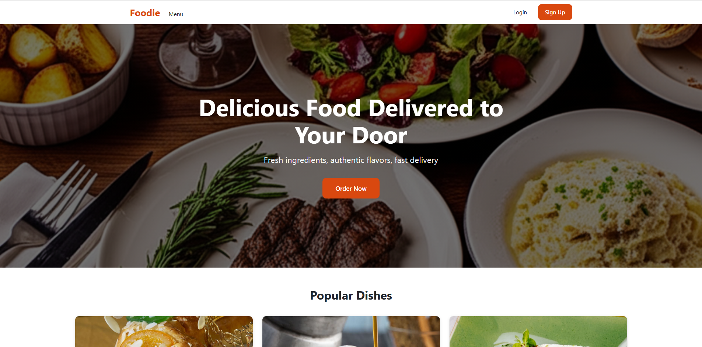

# [CHEMI RESTORANI AI ESE]

A restaurant website I built for school and as part of my portfolio. This is the Angular frontend. It talks to a REST API for accounts, dishes, and the rest of the data.



## Built with

- Angular
- TypeScript
- [Backend, e.g. Spring Boot / ASP.NET Core / Node.js]
- [Database]

## Running it locally

You need Node.js and the Angular CLI installed.

```bash
git clone https://github.com/NKK1337/[repo-name].git
cd [repo-name]
npm install
ng serve
```

Then open `http://localhost:4200`.

The app expects the API to be running. Set the API URL in `src/app/app.config.ts` or your environment file.

## API

Every endpoint returns the same `ApiResponse` shape:

```json
{
  "success": true,
  "message": "Some message",
  "data": {}
}
```

Endpoints that need a logged-in user expect a token in the `Authorization` header.

## Notes

This is a school project that I keep working on, so things change as I add more. If you find a bug, feel free to open an issue.

Made by [NKK1337](https://github.com/NKK1337).